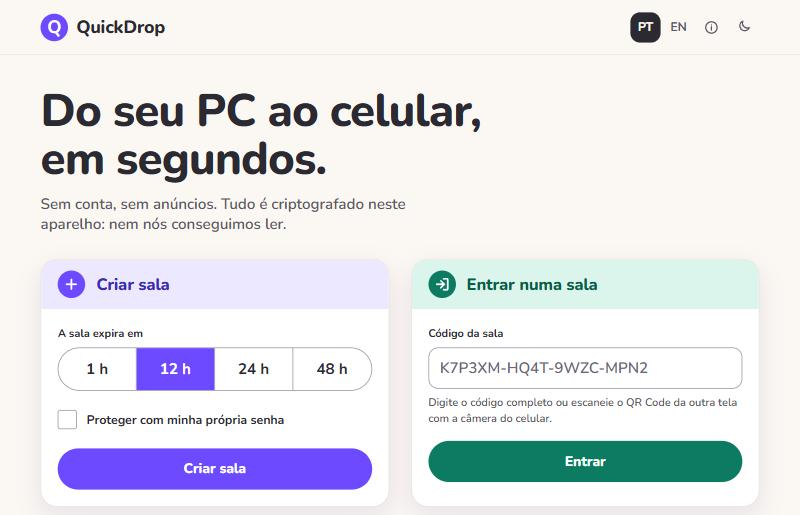
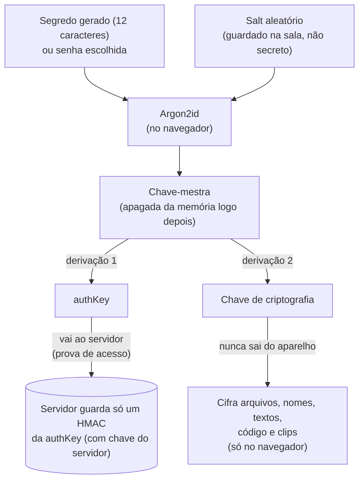
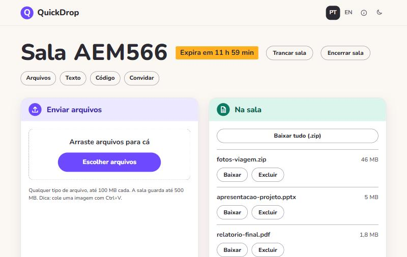
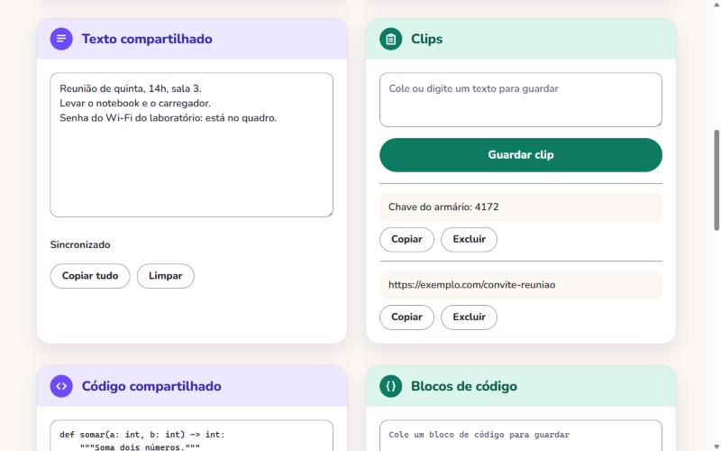
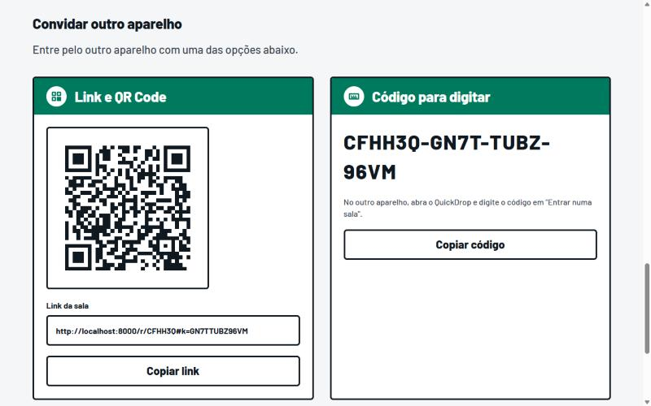
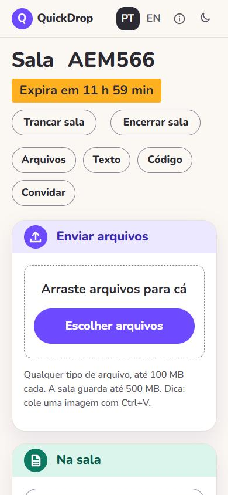
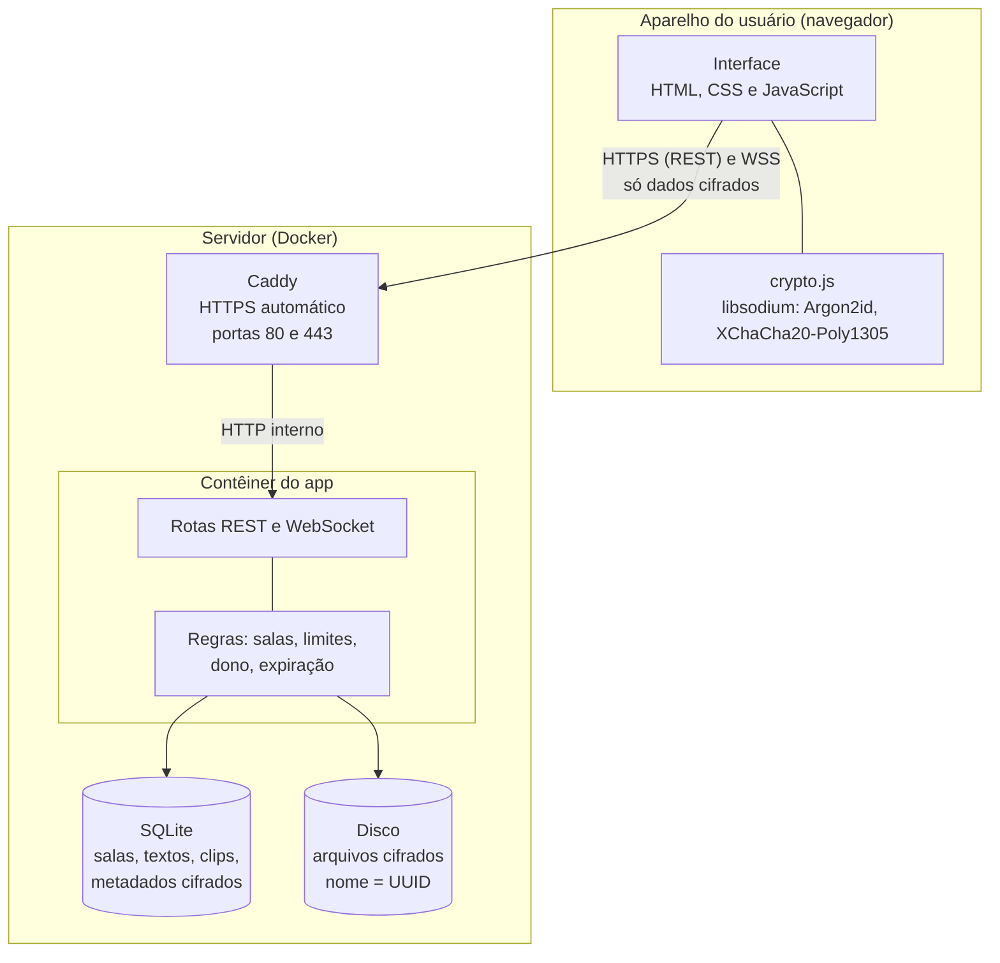

<div align="center">

# QuickDrop

**Passe arquivos e textos de um aparelho para outro em segundos. Sem conta, sem anúncios e com criptografia de ponta a ponta: nem o servidor consegue ler o que você envia.**

[](https://github.com/gbrielzera/QuickDrop/actions/workflows/uptime.yml)


**[Experimente agora](https://quickdrop-syoti.mexicocentral.cloudapp.azure.com)** · [Como rodar](docs/COMO-RODAR.md) · [Visão do produto](docs/VISAO.md) · [Requisitos](docs/REQUISITOS.md)



</div>

> O endereço acima é uma demonstração em um servidor pequeno e gratuito, com limites de uso. As salas duram de 1 a 48 horas e tudo é apagado ao final.

## Sumário

- [Por que o QuickDrop](#por-que-o-quickdrop)
- [Recursos](#recursos)
- [Como funciona](#como-funciona)
- [Telas](#telas)
- [Tecnologias](#tecnologias)
- [Arquitetura](#arquitetura)
- [Começando](#começando)
- [Configuração](#configuração)
- [Estrutura do projeto](#estrutura-do-projeto)
- [Testes e qualidade](#testes-e-qualidade)
- [Segurança](#segurança)
- [Hospedagem e operação](#hospedagem-e-operação)
- [Documentação](#documentação)
- [Estado do projeto](#estado-do-projeto)
- [Licença](#licença)

## Por que o QuickDrop

Passar um print do celular para o PC, ou um arquivo para o computador de um amigo, costuma exigir e-mail, mensagem para si mesmo, login em uma nuvem ou um site de envio cheio de anúncios, que ainda guarda o arquivo em texto puro.

O QuickDrop troca isso por uma **sala temporária**: você cria, entra pelo outro aparelho com um QR Code e os dois veem os mesmos arquivos, o mesmo texto e o mesmo código, em tempo real. Quando o tempo acaba, tudo some.

## Recursos

**Salas**
- Criação em um toque, com expiração de **1, 12, 24 ou 48 horas**.
- Entrada por **QR Code**, link ou código para digitar; senha própria opcional.
- O dono pode **trancar** a sala (ninguém novo entra) ou **encerrá-la** na hora.
- Aparelhos conectados e tempo restante sempre visíveis.

**Arquivos**
- **Qualquer tipo**, até 100 MB cada e 500 MB por sala; arraste e solte, ou cole uma imagem com `Ctrl+V`.
- Pré-visualização de imagens e **download de tudo em .zip**, montado no próprio navegador.

**Texto e código**
- Editor de **texto compartilhado** em tempo real, com tratamento de edição simultânea.
- Editor de **código** que preserva a indentação (`Tab` e `Shift+Tab`), sem ligaduras, e **blocos de código** que são copiados exatamente como guardados.
- **Clips** para guardar trechos de texto e copiar depois.

**Experiência**
- Pensado primeiro para o **celular**; português do Brasil e inglês; tema claro e escuro (segue o aparelho, com um botão discreto no topo para trocar); instalável como app (PWA); uso completo por teclado.

## Como funciona

1. **Criar:** o navegador gera um segredo aleatório e deriva as chaves de criptografia.
2. **Convidar:** o outro aparelho entra pelo QR Code ou link. O segredo viaja depois do `#` do endereço, parte que **o navegador nunca envia ao servidor**.
3. **Trocar:** arquivos, textos, código e clips são cifrados no navegador antes de sair do aparelho e aparecem nos outros em tempo real.
4. **Sumir:** ao expirar ou ser encerrada, a sala é apagada de verdade (disco e banco).

### O que o servidor sabe (e o que não sabe)

| O servidor **sabe** | O servidor **não sabe** |
|---|---|
| Que existe uma sala, o código dela e quando expira | A senha, o segredo e a chave de criptografia |
| O tamanho aproximado dos arquivos cifrados | O nome, o tipo, o tamanho real e o conteúdo dos arquivos |
| Quantos aparelhos estão conectados | O conteúdo dos textos, do código e dos clips |
| Contagens de eventos de segurança, sem IP nem código | Quem são as pessoas |

### Chaves de criptografia



> **Limite honesto:** quem esquece a senha escolhida perde o conteúdo, pois ninguém consegue recuperá-lo. E, como em qualquer criptografia feita numa página web, o JavaScript vem do servidor: por isso ele é endurecido e monitorado (veja [Segurança](#segurança)).

## Telas

<table>
  <tr>
    <td width="50%"><br><sub>Arquivos da sala, com envio por arrastar e soltar</sub></td>
    <td width="50%"><br><sub>Texto compartilhado e clips</sub></td>
  </tr>
  <tr>
    <td width="50%"><br><sub>Convite por QR Code, link ou código</sub></td>
    <td width="50%" align="center"><br><sub>A mesma sala no celular</sub></td>
  </tr>
</table>

## Tecnologias

| Camada | Tecnologia |
|---|---|
| Backend | Python, FastAPI, Uvicorn, SQLAlchemy 2 (assíncrono) |
| Banco e arquivos | SQLite (aiosqlite) e disco local, só com dados cifrados |
| Tempo real | WebSocket, com reconexão e reconferência automáticas |
| Criptografia | libsodium no navegador: Argon2id, XChaCha20-Poly1305; HMAC-SHA256 no servidor |
| Frontend | HTML (Jinja2), CSS e JavaScript puro, sem framework nem etapa de build |
| Qualidade | pytest, `node --test`, ruff, pip-audit, Dependabot |
| Implantação | Docker Compose, Caddy (HTTPS automático), GitHub Actions |

## Arquitetura



Mais diagramas (entrada na sala, envio de arquivo, conflito de edição, modelo de dados, ciclo de vida da sala e implantação) estão no [Documento de Visão](docs/VISAO.md).

## Começando

### Pré-requisitos

- Python 3.12 ou mais novo (testado com 3.14) e Node.js recente (testado com 24), este só para os testes do frontend.
- Docker, se preferir rodar em contêiner.

### Rodar localmente

```powershell
cd backend
python -m venv .venv
.venv\Scripts\Activate.ps1
pip install -r requirements-dev.txt
copy .env.example .env
```

Abra o `backend/.env` e troque o valor de `SECRET_KEY` por um texto aleatório. Para gerar um:

```powershell
python -c "import secrets; print(secrets.token_urlsafe(48))"
```

Depois, inicie o servidor e abra **http://localhost:8000**:

```powershell
uvicorn app.main:app --reload
```

Para abrir o site em outro aparelho da mesma rede (por exemplo, o celular), inicie com `--host 0.0.0.0` e **sem** `--reload`. O passo a passo completo, com solução de problemas, está em [docs/COMO-RODAR.md](docs/COMO-RODAR.md).

### Rodar com Docker

```bash
cp .env.production.example .env      # preencha DOMAIN e SECRET_KEY
docker compose up -d --build
```

Para testar no seu computador, use `DOMAIN=localhost` (o Caddy cria um certificado local). Para publicar na internet, siga o [guia de implantação](docs/DEPLOY.md).

## Configuração

Todas as configurações vêm de variáveis de ambiente ou do arquivo `backend/.env`. As principais:

| Variável | Padrão | Para que serve |
|---|---|---|
| `SECRET_KEY` | *(obrigatória)* | Assina os cookies das salas |
| `DEBUG` | `false` | Liga a documentação da API e páginas de desenvolvimento |
| `COOKIE_SECURE` | `false` | Use `true` em HTTPS (liga também o HSTS) |
| `MAX_FILE_SIZE_MB` / `MAX_ROOM_SIZE_MB` | `100` / `500` | Limites de arquivo e de sala |
| `ALLOWED_TTL_HOURS` / `DEFAULT_TTL_HOURS` | `1,12,24,48` / `12` | Opções de expiração da sala |
| `MAX_TOTAL_STORAGE_MB` / `MAX_ACTIVE_ROOMS` | `30720` / `500` | Limites do servidor inteiro |
| `DATABASE_URL` / `STORAGE_DIR` | pasta `backend/` | Onde ficam o banco e os arquivos |
| `CONTACT_EMAIL` | vazio | Contato para denúncias, mostrado na página Sobre |

A lista completa, com todos os limites de tentativas, está em [docs/REQUISITOS.md](docs/REQUISITOS.md#93-limites-e-constantes) e em [`backend/.env.example`](backend/.env.example).

## Estrutura do projeto

```
backend/                 Python / FastAPI
  app/
    routers/             rotas: salas, arquivos, texto e código, clips, WebSocket, páginas
    *_service.py         regras e acesso ao banco
    security*.py         hash, cabeçalhos de segurança e contagem de eventos
    rate_limit.py        limites de tentativas por IP
  tests/                 testes automatizados (pytest)
frontend/                HTML, CSS e JavaScript
  templates/             páginas (Jinja2)
  static/js/             interface e criptografia (crypto.js é o único arquivo que mexe em chaves)
  tests/                 testes do JavaScript (node --test)
docs/                    visão, requisitos, planejamento, guias de uso e implantação
scripts/                 rotina de atualização do servidor e verificação de bibliotecas
.github/                 verificações automáticas e Dependabot
Dockerfile · docker-compose.yml · Caddyfile
```

As regras de código do projeto estão em [CLAUDE.md](CLAUDE.md): código simples e legível, nomes completos, funções pequenas e backend e frontend em pastas separadas.

## Testes e qualidade

```powershell
cd backend
pytest                    # 200 testes do servidor
ruff check . ; ruff format --check .

cd ..\frontend
npm test                  # 74 testes do JavaScript (criptografia, zip, códigos de sala...)
```

- Os testes confirmam, por exemplo, que **nenhum conteúdo legível chega ao banco nem ao disco**, que o convidado não consegue encerrar a sala e que os limites de tamanho e de tentativas funcionam.
- As dependências são auditadas com `pip-audit` e acompanhadas pelo Dependabot; as bibliotecas copiadas para `frontend/static/js/vendor/` têm verificação mensal de versão.
- Uma verificação automática no GitHub confere o site a cada 15 minutos (o selo no topo mostra o resultado).

## Segurança

Resumo das proteções (detalhes no [Documento de Requisitos](docs/REQUISITOS.md#51-segurança-e-privacidade)):

- **Ponta a ponta:** o conteúdo é cifrado no navegador; o servidor guarda só dados embaralhados e um hash da chave de acesso.
- **Acesso:** segredo de 12 caracteres ou senha de 10+, Argon2id, cookies assinados, papéis de dono e convidado, sala trancável.
- **Aplicação:** validação estrita das entradas, limites por IP e globais, política de segurança de conteúdo (CSP) rígida, nenhum HTML de usuário, downloads sempre como anexo.
- **Servidor:** HTTPS com HSTS, SSH só por chave e só do administrador, contêiner sem privilégios, atualizações automáticas e alertas.
- **Privacidade:** sem contas, sem registro de IP nem de códigos de sala.

Encontrou uma vulnerabilidade? Veja como avisar em [SECURITY.md](SECURITY.md).

## Hospedagem e operação

A demonstração roda em uma máquina virtual pequena (1 vCPU e 1 GiB) com Docker e Caddy. O [guia de implantação](docs/DEPLOY.md) explica o passo a passo, as atualizações automáticas, os alertas e a manutenção. O custo da hospedagem é baixo ou zero; o motivo da escolha está em [docs/PLANEJAMENTO.md](docs/PLANEJAMENTO.md).

## Documentação

| Documento | Conteúdo |
|---|---|
| [Visão do produto](docs/VISAO.md) · [.docx](docs/VISAO.docx) | Problema, posicionamento, usuários, decisões, riscos e 13 diagramas |
| [Requisitos](docs/REQUISITOS.md) · [.docx](docs/REQUISITOS.docx) | Regras de negócio, requisitos funcionais e não funcionais, casos de uso e critérios de aceitação |
| [Como rodar](docs/COMO-RODAR.md) | Passo a passo para usar no computador e no celular, e solução de problemas |
| [Implantação](docs/DEPLOY.md) | Colocar na internet, atualizar e manter |
| [Planejamento](docs/PLANEJAMENTO.md) | Decisões e histórico de cada fase |
| [Design](DESIGN.md) · [Produto](PRODUCT.md) | Sistema visual ("Encontro suave": violeta, verde, Nunito, temas claro e escuro) e princípios do produto |

Os arquivos `.docx` são gerados a partir dos `.md`: edite o `.md` e gere de novo.

## Estado do projeto

Todas as fases planejadas estão concluídas e o produto está no ar: salas, arquivos cifrados, tempo real, texto, código e clips, expiração, segurança, imagens, zip, PWA, dono e trancar sala, hospedagem, monitoramento e atualizações automáticas.

**Já validado em celular real (4G):** entrada numa sala com senha em 2,08 s, envio de 100 MB em 1 min 36 s e reconexão com a tela apagada.

**Ainda a validar:** outros navegadores e uma auditoria de acessibilidade (a meta é WCAG 2.1 AA).

**Ideias futuras:** realce de sintaxe nos blocos de código, "Compartilhar com..." do Android, edição simultânea sem conflito (CRDT), nome dos aparelhos e mais de um servidor.

## Licença

Este repositório **não tem licença**: o código está visível para consulta, mas nenhum direito de uso, cópia, modificação ou distribuição é concedido sem autorização do autor.

---

Feito por [gbrielzera](https://github.com/gbrielzera).
