# QuickDrop: Documento de Visão

| | |
|---|---|
| **Produto** | QuickDrop |
| **Versão do documento** | 1.0 |
| **Data** | 18/10/2026 |
| **Endereço** | https://quickdrop-syoti.mexicocentral.cloudapp.azure.com |
| **Documento irmão** | [Documento de Requisitos](REQUISITOS.md) (o que o sistema faz, em detalhe) |

> **Em uma frase:** o QuickDrop passa arquivos e textos de um aparelho para outro em segundos, sem conta e sem anúncios, e com criptografia de ponta a ponta: nem o servidor consegue ler o que você envia.

## Sumário

1. [Introdução](#1-introdução)
2. [O problema e a oportunidade](#2-o-problema-e-a-oportunidade)
3. [Posicionamento](#3-posicionamento)
4. [Usuários e partes interessadas](#4-usuários-e-partes-interessadas)
5. [Visão geral do produto](#5-visão-geral-do-produto)
6. [Diagramas](#6-diagramas)
7. [Recursos do produto](#7-recursos-do-produto)
8. [Decisões de arquitetura](#8-decisões-de-arquitetura)
9. [Restrições e premissas](#9-restrições-e-premissas)
10. [Faixas de qualidade](#10-faixas-de-qualidade)
11. [Riscos](#11-riscos)
12. [Indicadores de sucesso](#12-indicadores-de-sucesso)
13. [Estado atual e roteiro](#13-estado-atual-e-roteiro)

---

## 1. Introdução

### 1.1 Finalidade
Apresentar **a visão do QuickDrop**: por que existe, para quem, o que promete, como é construído em alto nível e quais são seus limites. É um documento para dar contexto a quem chega ao projeto (pessoas, avaliadores, futuros colaboradores). Os detalhes verificáveis estão no [Documento de Requisitos](REQUISITOS.md).

### 1.2 Escopo
O sistema inteiro: o site (frontend), o servidor (backend), a criptografia no navegador, a hospedagem e as rotinas de operação.

### 1.3 Referências
[`PRODUCT.md`](../PRODUCT.md) (propósito e princípios), [`PLANEJAMENTO.md`](PLANEJAMENTO.md) (decisões e histórico por fase), [`DESIGN.md`](../DESIGN.md) (sistema visual), [`DEPLOY.md`](DEPLOY.md) (operação), [`COMO-RODAR.md`](COMO-RODAR.md) (uso local).

---

## 2. O problema e a oportunidade

### 2.1 O problema
Quem precisa passar **um arquivo, um print ou um texto** de um aparelho para outro (do PC para o celular, do celular para o computador de um amigo) costuma recorrer a:

| Alternativa comum | Por que incomoda |
|---|---|
| Enviar para si mesmo por e-mail ou aplicativo de mensagem | Vários passos, limite de tamanho, o conteúdo fica guardado para sempre em outro serviço |
| Serviços de nuvem | Exigem conta, login nos dois aparelhos e deixam os arquivos lá |
| Sites de envio de arquivos | Lentos, cheios de anúncios, e o arquivo fica guardado em texto puro no servidor |
| Cabo ou Bluetooth | Nem sempre à mão, lento ou incompatível entre sistemas |

### 2.2 A oportunidade
Uma **sala temporária** abre em segundos, vale por algumas horas e some. Não precisa de conta. Se a criptografia for feita **no próprio navegador**, o serviço pode prometer algo que a maioria dos concorrentes não pode: **"nem nós conseguimos ler"**.

---

## 3. Posicionamento

| | |
|---|---|
| **Para** | qualquer pessoa que precisa passar arquivos ou textos entre aparelhos |
| **Que** | quer terminar a tarefa em segundos, sem criar conta nem aprender nada |
| **O** QuickDrop | é um site de salas temporárias em tempo real |
| **Que** | criptografa tudo no navegador e apaga tudo sozinho ao fim do tempo |
| **Diferente de** | e-mail, nuvens com conta e sites de upload com anúncios |
| **Nosso produto** | não pede cadastro, não guarda nada legível e não mostra anúncios |

### 3.1 Princípios do produto

1. **Velocidade antes de tudo:** da abertura do site à transferência, o mínimo de passos.
2. **Privacidade verdadeira e explicável:** só afirmar o que a criptografia realmente garante, em linguagem simples.
3. **Sem conta, sem atrito:** o código e o link são a identidade.
4. **Temporário por padrão:** tudo expira e a pessoa sempre vê quanto tempo resta.
5. **Funciona bem no celular**, na rede local e na internet.

### 3.2 O que o QuickDrop **não** promete
- Não recupera senha esquecida (ninguém consegue, nem o administrador).
- Não impede que um servidor comprometido entregue código malicioso: a criptografia no navegador depende do JavaScript que o servidor entrega. Por isso o servidor é endurecido e monitorado.
- Não substitui armazenamento permanente: salas duram de 1 a 48 horas.

---

## 4. Usuários e partes interessadas

### 4.1 Perfis de usuário

| Perfil | Situação típica | O que precisa |
|---|---|---|
| **Pessoa com dois aparelhos** | Print no celular que precisa ir para o PC; arquivo do PC para o celular | Criar a sala em um aparelho e entrar no outro com um QR Code |
| **Estudante ou profissional em computador compartilhado** | Pegar um arquivo num computador de laboratório sem fazer login | Entrar sem conta e não deixar rastros: sala que some sozinha |
| **Quem passa código ou texto** | Colar um trecho de código mantendo a indentação, ou um texto longo, em outro aparelho | Editor e blocos de código com formatação exata e botão de copiar |
| **Grupo pequeno** | Trocar fotos e documentos com amigos presentes | Um link ou QR Code que todos usam; o dono pode trancar a sala |

### 4.2 Partes interessadas

| Parte | Interesse |
|---|---|
| **Usuários** | Rapidez, privacidade, sem cadastro |
| **Administrador / autor** | Servidor barato e estável, pouca manutenção, código simples de entender |
| **Quem reportar abuso** | Canal de denúncia (página Sobre) |
| **Provedor de hospedagem** | Uso dentro das regras (conteúdo ilegal e abuso de recursos) |

### 4.3 Ambiente de uso
Navegadores modernos em computador e celular (a interface é pensada primeiro para o celular), em rede local ou na internet, em português do Brasil ou inglês.

---

## 5. Visão geral do produto

### 5.1 Como funciona, em 4 passos

1. **Criar:** a pessoa abre o site e toca em *Criar sala*. O navegador gera um segredo aleatório e deriva as chaves de criptografia.
2. **Convidar:** o outro aparelho entra pelo **QR Code**, pelo **link** ou digitando o **código**. O segredo viaja no fragmento do link (`#k=`), que o navegador nunca envia ao servidor.
3. **Trocar:** arquivos, textos, código e clips aparecem nos dois aparelhos em tempo real.
4. **Sumir:** quando o tempo acaba, ou o dono encerra, tudo é apagado de verdade.

### 5.2 Garantias de privacidade

| O servidor **sabe** | O servidor **não sabe** |
|---|---|
| Que existe uma sala, o código dela, quando expira | A senha, o segredo e a chave de criptografia |
| O tamanho aproximado dos arquivos cifrados | Nome, tipo, tamanho real e conteúdo dos arquivos |
| Quantos aparelhos estão conectados | O conteúdo dos textos, do código e dos clips |
| Contagens de eventos de segurança (sem IP nem código) | Quem são as pessoas |

---

## 6. Diagramas

Os diagramas abaixo estão em [Mermaid](https://mermaid.js.org): o GitHub os desenha sozinho.

### 6.1 Contexto do sistema

Quem usa o QuickDrop e com quais serviços externos ele conversa.

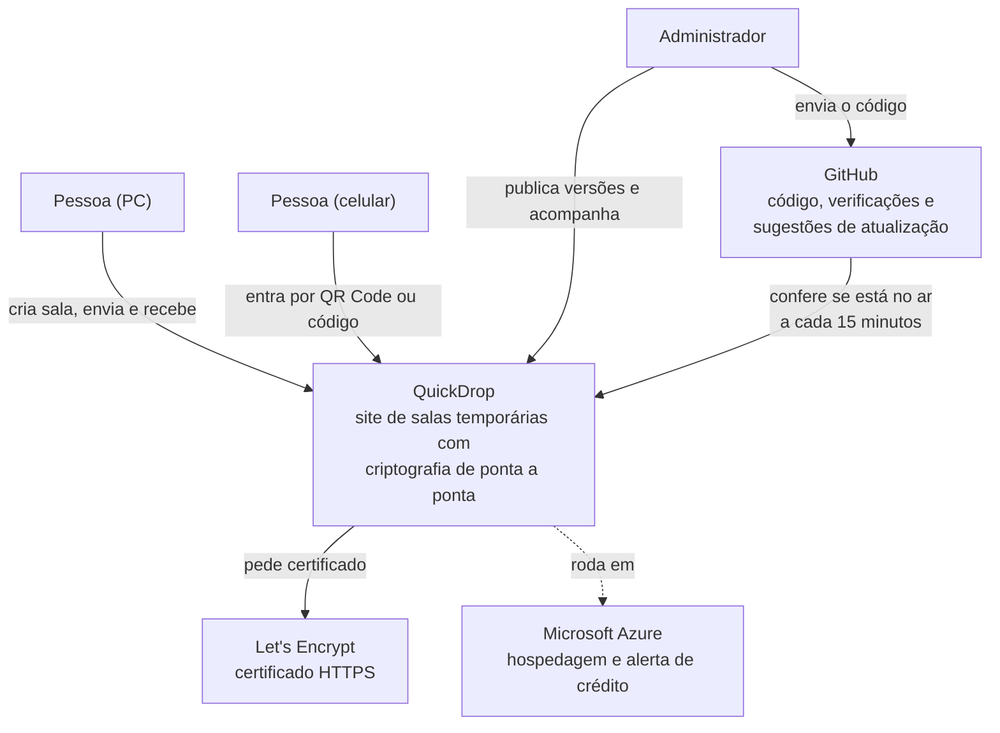

### 6.2 Contêineres (visão de arquitetura)

As peças que compõem o sistema e como conversam.

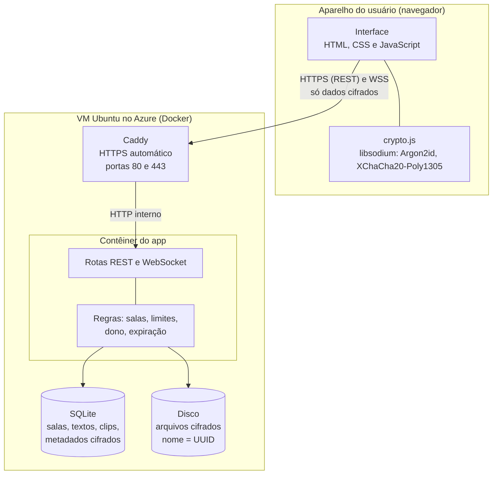

### 6.3 Hierarquia de chaves

De onde vem cada chave e o que vai (ou não) para o servidor.

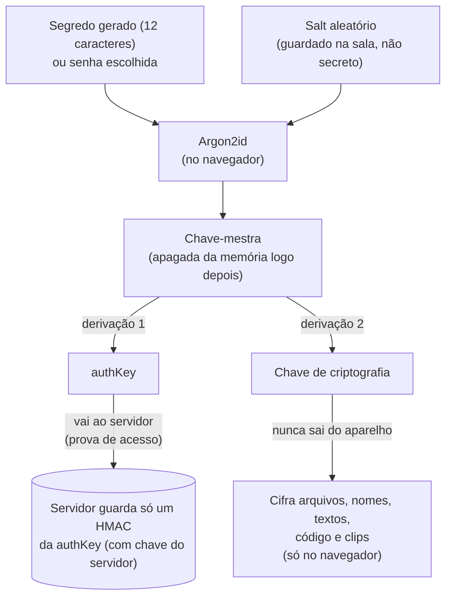

### 6.4 Criar sala e entrar pelo QR Code

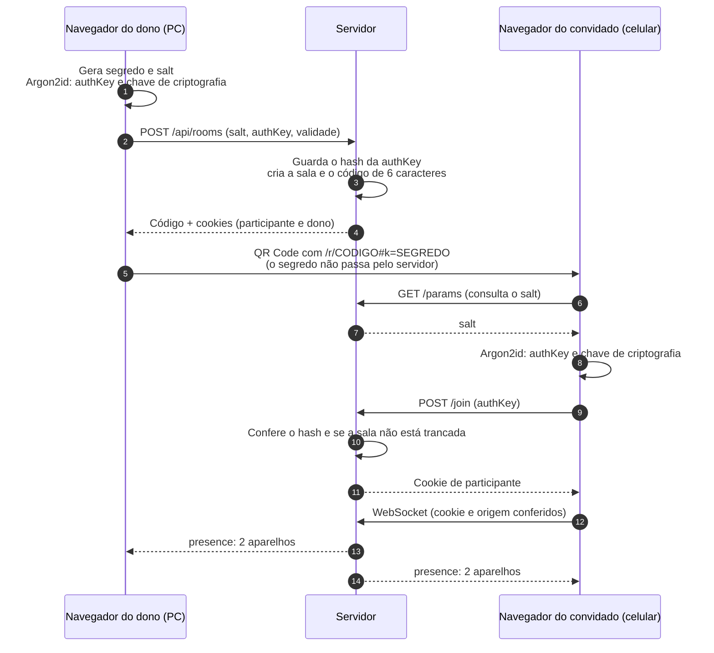

### 6.5 Enviar arquivo criptografado

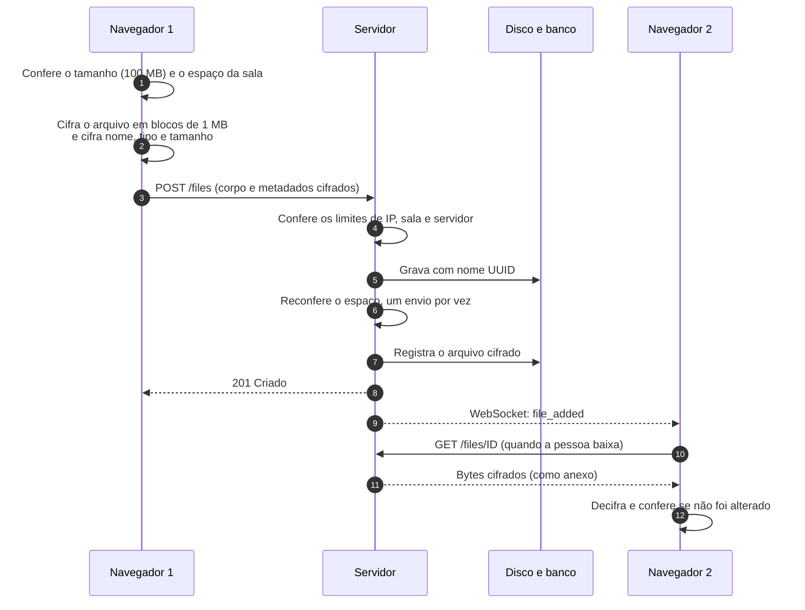

### 6.6 Edição do texto compartilhado com conflito

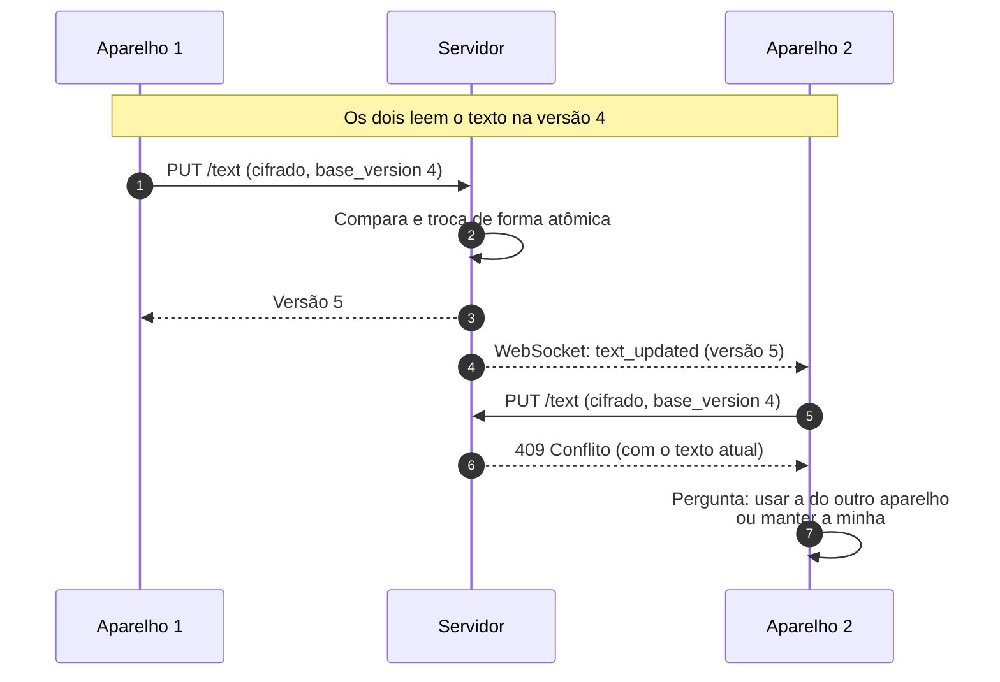

### 6.7 Modelo de dados

O servidor só guarda dados cifrados (`BLOB`). Nenhuma tabela tem conteúdo legível.

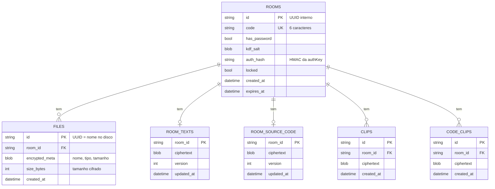

Ao apagar uma sala, o banco apaga em cascata tudo o que depende dela; a pasta de arquivos da sala é removida junto.

### 6.8 Ciclo de vida da sala

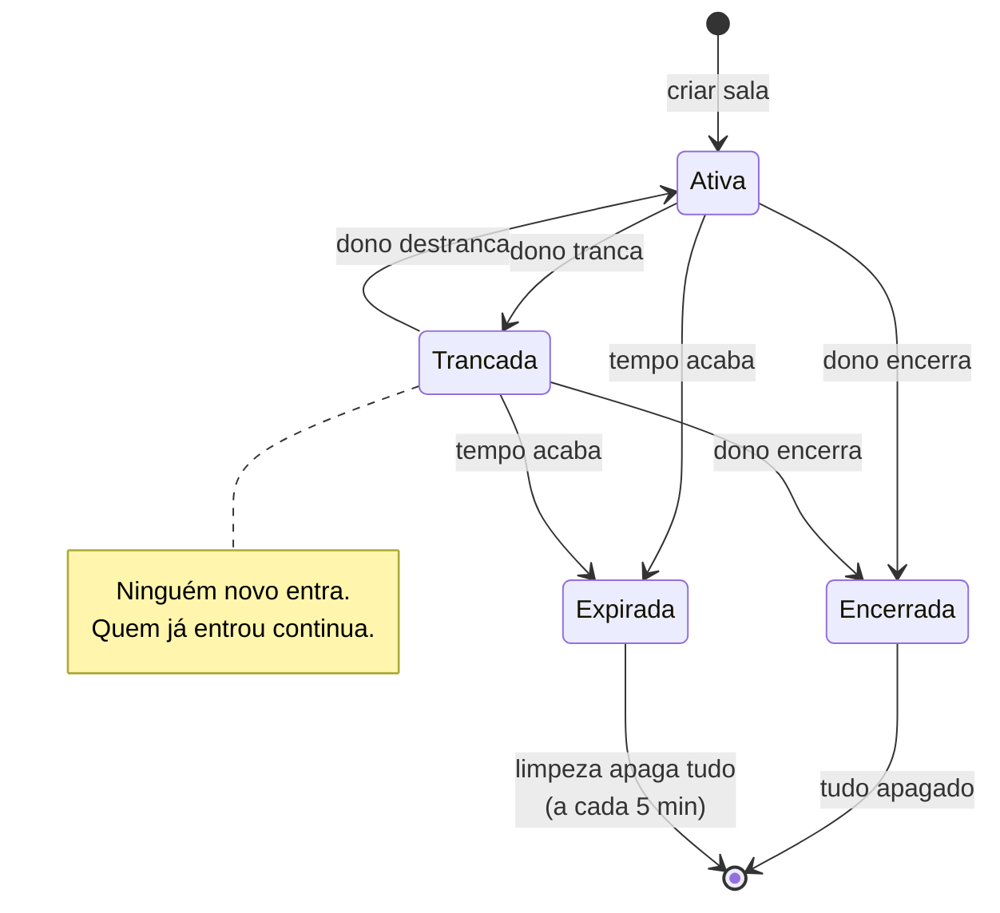

### 6.9 Casos de uso

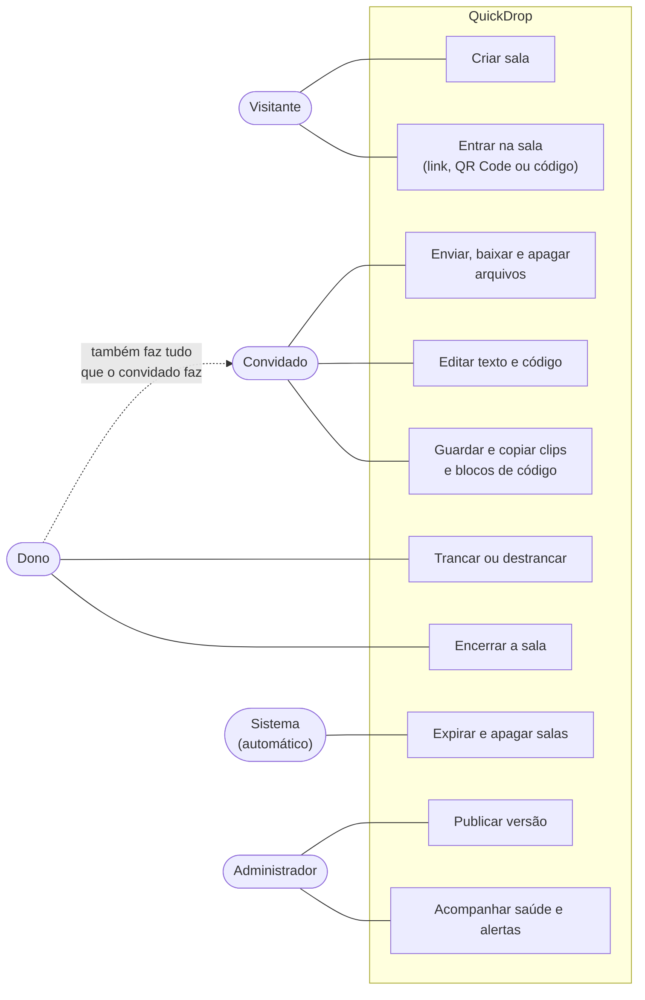

### 6.10 Implantação (produção)

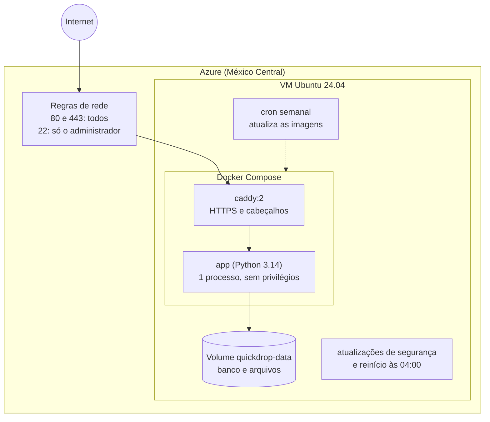

### 6.11 Operação e alertas

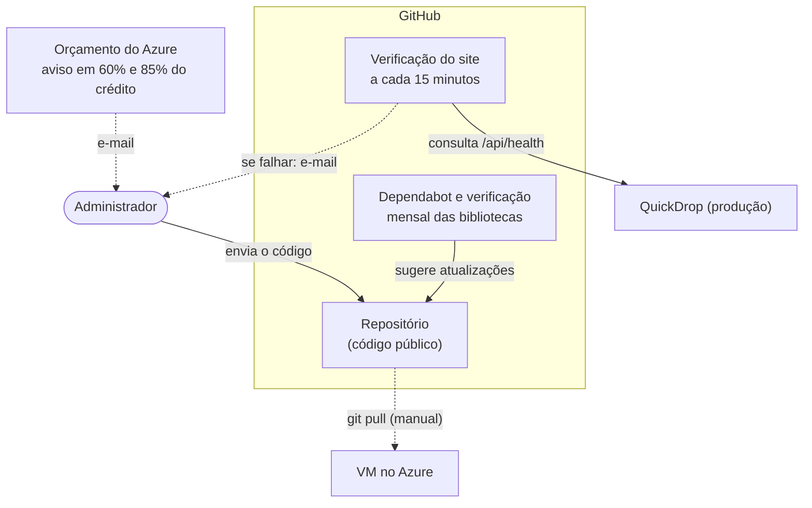

### 6.12 Camadas de segurança

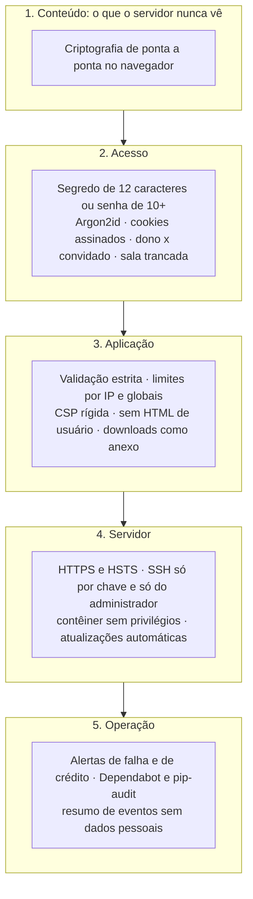

---

## 7. Recursos do produto

| Grupo | Recursos |
|---|---|
| **Salas** | Criar com expiração de 1, 12, 24 ou 48 h; código curto; QR Code; link; código completo; senha própria opcional; trancar; encerrar; tempo restante; aparelhos conectados |
| **Arquivos** | Qualquer tipo, até 100 MB cada e 500 MB por sala; arrastar e soltar; colar imagem com Ctrl+V; progresso; baixar; apagar; pré-visualizar imagens; baixar tudo em .zip |
| **Texto** | Editor compartilhado em tempo real, com tratamento de conflito; clips para guardar e copiar trechos |
| **Código** | Editor com indentação preservada (Tab, Shift+Tab); blocos de código copiados exatamente como guardados |
| **Segurança** | Criptografia de ponta a ponta; HTTPS; limites contra abuso; expiração automática; dono e convidados |
| **Experiência** | Português e inglês; tema claro e escuro; pensado para o celular; instalável como app; acessível por teclado |
| **Operação** | Docker; HTTPS automático; atualizações automáticas; alertas; documentação de implantação |

Os requisitos detalhados e os critérios de aceitação estão no [Documento de Requisitos](REQUISITOS.md).

---

## 8. Decisões de arquitetura

| Decisão | Escolha | Motivo | Consequência |
|---|---|---|---|
| Criptografia | No navegador (libsodium), desde o primeiro dia | Permite prometer que o servidor não lê nada | Senha esquecida = conteúdo perdido; depende de o servidor entregar JavaScript íntegro |
| Entrada na sala | QR Code ou link (segredo em `#k=`) como caminho principal; código completo como alternativa | Rápido no celular e o segredo nunca chega ao servidor | O código completo para digitar é longo (21 caracteres) |
| Backend | FastAPI (Python) com Uvicorn | Simples, rápido e com WebSocket nativo | 1 processo: estado em memória |
| Frontend | HTML (Jinja2), CSS e JavaScript puro | Sem etapa de build; fácil de entender | Um pouco mais de código manual |
| Banco | SQLite | Um arquivo; sem servidor de banco para administrar | Um servidor só; migrações manuais |
| Arquivos | Disco local, nome UUID, só bytes cifrados | Simples e barato | Limite pelo disco da VM |
| Tempo real | WebSocket por sala, com reconexão e reconferência | Resposta imediata | Conexões em memória; um servidor só |
| Conflitos de texto | Versão + troca atômica; a pessoa escolhe | Simples e sem perder texto | Não mistura edições (CRDT ficou para o futuro) |
| Acesso | Cookie assinado por sala + cookie de dono | Sem contas | Dono é o navegador, não a pessoa |
| Hospedagem | VM do Azure for Students + Docker + Caddy | Grátis (com crédito), HTTPS automático | Crédito de ~7 meses |
| Operação | GitHub Actions, Dependabot, cron e unattended-upgrades | Sem custo e quase sem manutenção | Depende de o GitHub manter os agendamentos ativos |
| Design | Sistema visual "Linhas de Metrô" | Diferencia o produto e explica o caminho da transferência | Documentado em `DESIGN.md` |

---

## 9. Restrições e premissas

**Restrições:** custo próximo de zero; um único servidor pequeno (1 vCPU e 1 GiB); sem contas nem recuperação de senha; código simples, em pastas separadas para backend e frontend; criptografia concentrada em um arquivo.

**Premissas:** navegadores atualizados; uso por poucas pessoas por sala; conteúdo temporário; o administrador acompanha os alertas por e-mail.

---

## 10. Faixas de qualidade

| Qualidade | Meta |
|---|---|
| **Segurança e privacidade** | Servidor sem acesso ao conteúdo; HTTPS; limites contra abuso; segredo com ~59 bits; senha própria com 10+ caracteres |
| **Desempenho** | Derivar as chaves em menos de ~1 s no celular; arquivos processados em blocos de 1 MB |
| **Usabilidade** | Transferência concluída sem aprender nada, em poucos passos |
| **Acessibilidade** | WCAG 2.1 AA (alvo; sem auditoria formal) |
| **Disponibilidade** | Reinício automático; alerta se o site cair |
| **Manutenibilidade** | Código limpo, 195 testes no backend e 72 no frontend, documentação atualizada |
| **Portabilidade** | Docker: o mesmo pacote roda em qualquer servidor |

---

## 11. Riscos

Probabilidade (P) e impacto (I): **B** baixo, **M** médio, **A** alto.

| # | Risco | P | I | Mitigação | Estado |
|---|---|---|---|---|---|
| R1 | O crédito do Azure acaba em cerca de 7 meses | A | M | Alerta de 60% e 85%; o Docker permite migrar de hospedagem em cerca de 20 minutos | Monitorado |
| R2 | Servidor comprometido entrega JavaScript malicioso | B | A | SSH restrito e só por chave, contêiner sem privilégios, atualizações automáticas, CSP rígida; limitação explicada na página Sobre | Mitigado em parte |
| R3 | Uso para enviar conteúdo ilegal ou malware | M | M | Salas temporárias; contato para denúncia; a ação possível é encerrar a sala | Aceito |
| R4 | Ataque de negação de serviço ou lotação do servidor | M | M | Limites por IP e globais, conferência da senha instantânea (HMAC), contagem de eventos | Mitigado |
| R5 | Senha fraca escolhida pela pessoa | M | A | Mínimo de 10 caracteres; segredo gerado de 12; Argon2id | Mitigado em parte |
| R6 | Link ou QR Code compartilhado com quem não deveria | M | M | Dono pode trancar ou encerrar; segredo some da barra de endereço; salas expiram | Mitigado em parte |
| R7 | Queda da hospedagem ou da máquina virtual | B | M | Reinício automático, alerta a cada 15 min, plano de recuperação documentado | Mitigado |
| R8 | Navegador antigo sem WebAssembly ou WebSocket | B | M | Mensagem de erro; recomendações de navegadores atualizados | Aceito |
| R9 | Entrada lenta no celular (derivação das chaves e rede) | M | M | Medido ~4 s; módulos carregados em paralelo, cache das bibliotecas e menos idas ao servidor; a medir de novo | **Em medição** |
| R10 | Rotinas agendadas do GitHub desativadas por inatividade (60 dias) | M | B | Lembrete em `DEPLOY.md`; reativar na aba Actions | Documentado |
| R11 | Perda da chave SSH ou do arquivo `.env` | B | M | Guardar cópia em cofre de senhas; recriar a VM a partir do repositório | A fazer pelo administrador |

---

## 12. Indicadores de sucesso

O produto **ainda não tem usuários além do autor**, então não há números reais de uso; nenhuma estatística foi inventada. Os indicadores a acompanhar:

| Indicador | Como medir | Meta |
|---|---|---|
| Tempo para concluir uma transferência entre dois aparelhos | Teste com pessoas | Menos de 30 s |
| Transferências concluídas sem ajuda | Teste de usabilidade | 9 em cada 10 |
| Tempo de entrada com senha no celular | Medição em aparelho | Até ~3 s (medido ~4 s antes das otimizações) |
| Disponibilidade do site | Verificação a cada 15 min | 99% ao mês |
| Vulnerabilidades conhecidas nas dependências | `pip-audit`, Dependabot | Zero em aberto |
| Cobertura de testes automatizados | Contagem | Todo requisito essencial com teste ou verificação registrada |

---

## 13. Estado atual e roteiro

### 13.1 Fases concluídas

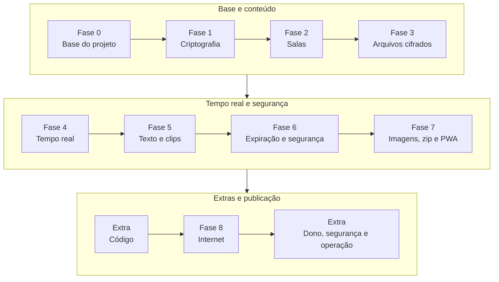

### 13.2 O que falta
- **Validar em aparelho real:** tempo de entrada com senha no celular (medir de novo depois das otimizações), outros navegadores e acessibilidade com leitores de tela. Já validados em celular real: 100 MB no 4G (1 min 36 s) e reconexão com a tela apagada.
- **Decidir a hospedagem depois do crédito** (cerca de 7 meses).
- **Ideias futuras:** realce de sintaxe, "Compartilhar com..." do Android, edição sem conflito (CRDT), nome dos aparelhos, mais de um servidor.

---

*Este documento descreve a visão do produto. As decisões e o histórico de cada fase estão no [`PLANEJAMENTO.md`](PLANEJAMENTO.md); os requisitos verificáveis, no [Documento de Requisitos](REQUISITOS.md).*
